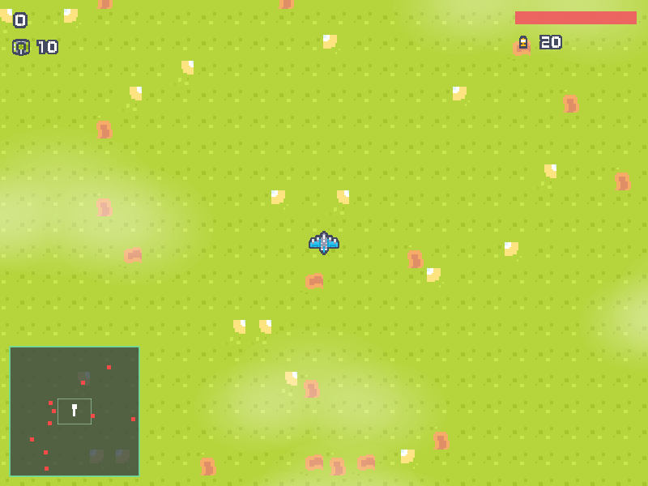

# Voo Rasante

Jogo 2D de avião visto de cima, feito para o Trabalho Grau A da disciplina de
Processamento Gráfico: Fundamentos (Unisinos, 2026/2).

## Equipe

- João Fidellis

## Descrição do Projeto

O jogador pilota um avião que está **sempre em movimento para frente** sobre um
mapa de 3072 x 3072 unidades. O avião fica fixo no centro da tela e o mundo
rola por baixo dele. O objetivo é destruir os 40 tanques espalhados pelo mapa
usando a metralhadora (munição infinita) ou as bombas (20 no estoque), sem
perder os 5 pontos de vida.

O avião voa **acima** dos veículos de solo, então passar por cima de um tanque
não causa dano nenhum. É justamente o que o jogador precisa fazer para
bombardear. A única coisa que tira vida é o tiro do tanque.

A bomba cai **parada no ponto exato em que o avião estava** quando a tecla foi
apertada, e explode após 0,75 s em um raio de 90 unidades. Ela não herda a
inércia do avião: a mira é "sobrevoe o alvo e solte".

Quando a bomba explode, o clarão toca uma **animação por spritesheet** de três
quadros.

No canto inferior esquerdo há um radar quadrado no estilo Ace Combat, que
mostra o mapa inteiro de uma vez, com pontos vermelhos para os inimigos e uma
seta branca que gira junto com o nariz do avião.

A decisão de projeto mais importante é a **separação entre as regras do jogo e
a renderização**, descrita abaixo.

### Controles

| Tecla | Ação |
|---|---|
| `A` `D` ou `←` `→` | Giram o nariz do avião |
| `W` `S` ou `↑` `↓` | Aumentam e diminuem a potência |
| `Espaço` ou botão esquerdo do mouse | Metralhadora, munição infinita |
| `B` ou botão direito do mouse | Solta uma bomba |
| `H` | Liga e desliga os contornos de hitbox |
| `R` | Reinicia após o fim de jogo |
| `F12` | Salva um screenshot |
| `Esc` | Sai |

## A separação entre gameplay e renderização

A regra é simples e **verificada pelo compilador**, não por disciplina:
nenhum arquivo de `src/game/` consegue incluir OpenGL.

O CMake define dois alvos. A biblioteca `game_core` contém todas as regras do
jogo e **não tem a GLAD nem a GLFW no seu include path**, apenas a GLM, que é
matemática pura. O executável `voo_rasante` tem o OpenGL e linka `game_core`.

Tentar escapar disso dá erro de compilação:

```
$ echo '#include <glad/glad.h>' >> src/game/player.cpp && cmake --build build
src/game/player.cpp:1:10: fatal error: 'glad/glad.h' file not found
```

Duas regras completam a fronteira:

1. Toda função de desenho recebe **`const World&`**, então o renderizador não
   tem como alterar o estado do jogo.
2. A dependência é de mão única: `core <- game <- render/platform <- main`.
   `main.cpp` é o único arquivo que enxerga os dois lados.

A prova prática disso é o terceiro alvo, `simtest`, que roda a simulação
completa do jogo (voo, tiro, colisão, bombas, câmera) **sem abrir janela e sem
linkar nenhum OpenGL**.

## Estrutura do Projeto

| Arquivo | Descrição |
|---|---|
| `CMakeLists.txt` | Três alvos: `game_core` (sem OpenGL), `voo_rasante` e `simtest` |
| `config/game.cfg` | Todos os números ajustáveis do jogo, lidos em tempo de execução |
| `shaders/sprite.vert` | Único vertex shader: aplica `projection * view * model` e recorta o UV |
| `shaders/sprite.frag` | Único fragment shader: textura multiplicada pelo `tint` |
| **`src/core/`** | **Dados compartilhados, sem OpenGL** |
| `core/types.h` | `Vec2`, `EntityKind`, `InputState`, `AABB` |
| `core/sprites.h` / `.cpp` | Tabela que liga cada sprite ao tile, tamanho e correção de ângulo |
| `core/config.h` / `.cpp` | Parser do arquivo de configuração |
| **`src/game/`** | **Regras do jogo, sem OpenGL (garantido pelo CMake)** |
| `game/world.h` / `.cpp` | Estado completo da simulação e a ordem de um passo |
| `game/entities.h` / `.cpp` | `Entity`, fábricas, integração e remoção por swap-and-pop |
| `game/player.h` / `.cpp` | Modelo de voo aplicado ao jogador |
| `game/weapons.h` / `.cpp` | Metralhadora, bombas e dano em área |
| `game/enemies.h` / `.cpp` | IA dos tanques e giro da torre |
| `game/collision.h` / `.cpp` | `aabbOverlap()` e os testes unitários |
| `game/tilemap.h` / `.cpp` | Geração procedural do terreno |
| `game/flight.h` | Convenção de ângulo e matemática de voo |
| `game/camera2d.h` | Câmera que segue o jogador e trava nas bordas |
| **`src/render/`** | **Único lugar com OpenGL** |
| `render/renderer.h` / `.cpp` | Quad unitário, matriz de model, primitivas e a ordem do frame |
| `render/atlas.h` / `.cpp` | Carregamento de textura, recorte de UV e texturas procedurais |
| `render/shader.h` / `.cpp` | Compilação e link dos shaders a partir de arquivos |
| `render/layers.h` / `.cpp` | Terreno com culling e as camadas de parallax |
| `render/hud.h` / `.cpp` | Pontuação, vida e bombas |
| `render/radar.h` / `.cpp` | Mapeamento mundo para radar |
| **`src/platform/`** | **GLFW: janela e entrada** |
| `platform/window.h` / `.cpp` | Criação do contexto, GLAD e screenshot |
| `platform/input.h` / `.cpp` | Teclado e mouse traduzidos em `InputState` |
| `src/main.cpp` | Loop de frame; o único arquivo que vê os dois lados |
| `src/simtest.cpp` | Simulação sem janela, usada como teste automatizado |
| `src/stb_impl.cpp` | Única unidade de tradução que gera o código da stb |

## Como os requisitos foram atendidos

### Buffers e shaders

Existe **um único VAO** no jogo inteiro: um quad unitário centrado na origem,
de (-0.5,-0.5) a (0.5,0.5), com um VBO intercalado de 4 floats por vértice
(2 de posição e 2 de coordenada de textura). Ele é enviado uma vez na
inicialização e nunca mais muda.

O quad é **centrado na origem** de propósito. Se o canto fosse a origem, todo
sprite giraria em torno do próprio canto superior esquerdo em vez do centro.

Também existe **um único par de shaders**. Isso é possível porque o fragment
shader multiplica a textura por um `tint`: com uma textura branca de 1x1 pixel,
o mesmo shader desenha quads de cor sólida, e por isso as balas, as barras do
HUD, os pontos do radar e os contornos de hitbox não precisam de programa
próprio.

### Matriz de projeção e matriz de model

```glsl
gl_Position = projection * view * model * vec4(aPos, 0.0, 1.0);
```

| Uniform | Quando é enviada |
|---|---|
| `projection` | Uma vez na inicialização: `ortho(0, 800, 600, 0, -1, 1)` |
| `view` | Uma vez por grupo de desenho (cada camada, o HUD, o radar) |
| `model` | A cada objeto desenhado |

A matriz de model é montada em `makeModelMatrix()` como `translate * rotate *
scale`. Na prática o vértice é escalado primeiro, depois girado, depois
movido. Inverter essa ordem faz o objeto orbitar a origem do mundo em vez de
girar no próprio eixo.

Os três componentes são animados em algum lugar do jogo: o **T** pelo voo e
pelas balas, o **R** pelo nariz do avião e pela torre do tanque, e o **S** pela
bomba, que encolhe enquanto cai.

### Sprites e spritesheets

Duas folhas são carregadas com a stb_image, forçando 4 canais:

| Folha | Tamanho | Grade | Conteúdo |
|---|---|---|---|
| `ships_packed.png` | 128x192 | 4 x 6 de 32x32 | 24 aeronaves |
| `tiles_packed.png` | 192x160 | 12 x 10 de 16x16 | Terreno, tanque, bombas e dígitos |

O recorte é feito por dois uniforms, `uvOffset` e `uvScale`, com um **recuo de
meio texel**. As folhas são empacotadas sem espaço entre os tiles, então
amostrar exatamente na divisa pode arredondar para o tile vizinho e aparecer
uma tira de 1 pixel do sprite errado na borda. Por isso a escala usa
`(tile - 1)` e não `(tile)`.

Duas decisões de textura que valem registro:

- **`GL_NEAREST` e sem mipmap.** Não é só escolha estética. As folhas são PNG
  indexado por paleta cujo índice transparente tem RGB preto, então
  `GL_LINEAR` interpolaria contra preto e deixaria um halo escuro em volta de
  cada sprite. Mipmap seria pior: o nível 1 mistura tiles vizinhos.
- **Não chamar `stbi_set_flip_vertically_on_load`.** Deixando a imagem como a
  stb entrega, o "de cabeça para baixo" da OpenGL cancela exatamente com a
  projeção de Y invertido. O resultado é um modelo mental único: tanto UV
  quanto tela medem a partir do canto superior esquerdo.

### Animação por spritesheet

A explosão da bomba é a única animação do jogo, e é deliberadamente a mais
simples que resolve o requisito.

Os quadros são **tiles consecutivos** na folha, então a animação inteira cabe em
dois números dentro da tabela de sprites: o primeiro tile e a quantidade de
quadros. Não existe lista de quadros, struct de animação nem temporizador
próprio.

```cpp
{AtlasId::Tiles, 4, 3, 46.0f, 46.0f, 0.0f},   // SPR_EXPLOSION: tiles 4, 5 e 6
```

Quem avança a animação é o **progresso do próprio objeto**, um valor de 0 a 1
que a entidade já tem. A explosão usa o quanto já passou do seu tempo de vida:

```cpp
float progresso = 1.0f - e.timer / w.cfg.explosionTime;
```

Esse mesmo número faz três coisas ao mesmo tempo, o que é o que dá a sensação de
explosão com tão pouco código:

| Progresso controla | Efeito |
|---|---|
| O quadro | tiles 4, 5 e 6, o clarão abre, alarga e se despedaça |
| A escala | o clarão cresce de 0,7 para 2,1 |
| O alpha | apaga no fim, com queda quadrática |

A decisão que vale explicar é o progresso vir do **temporizador da própria
entidade**, e não de um relógio global. Se o quadro fosse escolhido pelo tempo de
jogo, todas as explosões na tela piscariam juntas, em vez de cada uma tocar a sua
do começo.

A função que escolhe o quadro serve aos dois casos, animado e estático:

```cpp
int spriteFrameTile(const SpriteDef &def, float progresso)
{
    if (def.frames <= 1 || def.tile < 0) return def.tile;
    int quadro = (int)(progresso * (float)def.frames);
    quadro = std::min(std::max(quadro, 0), def.frames - 1);
    return def.tile + quadro;
}
```

O `clamp` não é detalhe: progresso exatamente 1,0 cairia no índice `frames`, que
não existe, e o desenho pegaria o tile vizinho na folha. Há um caso de teste só
para essa ponta.

### Camadas e parallax

Cada camada usa uma matriz de view com um **fator** diferente aplicado ao
deslocamento da câmera: `view = translate(-camera * fator)`.

| Camada | Fator | Observação |
|---|---|---|
| Terreno | 1.00 | Base opaca, desenhada com culling |
| Nuvens baixas | 1.15 | Desenhadas antes do avião, que passa por cima |
| Nuvens altas | 1.60 | Desenhadas depois, passam por cima do avião |
| HUD e radar | identidade | Presas à tela |

Num jogo visto de cima **todos os fatores são maiores ou iguais a 1**, e isso
tem justificativa física. A câmera está no alto olhando para baixo, então o
chão é o ponto mais distante e nada pode rolar mais devagar que ele. As nuvens
ficam entre a câmera e o chão, logo atravessam a tela mais rápido, e quanto
mais alta a nuvem, mais perto da câmera e maior o fator.

Não há sprite de nuvem no pacote da Kenney. A nuvem é um disco branco com alpha
caindo suavemente do centro para a borda, **gerado em código** em
`createCloudTexture()`. Essa camada também é a demonstração mais visível do
alpha blending.

### Culling do terreno

O mapa tem 96 x 96 = 9216 tiles, mas apenas os visíveis são desenhados, cerca
de 567 por frame. Cada tile é um desenho com sua própria matriz de model.

Juntar o mapa inteiro num VBO só seria mais rápido, mas esconderia exatamente o
conceito que o trabalho pede para demonstrar. A 567 desenhos o custo fica
abaixo de 2 ms, então a clareza vale mais aqui.

### Colisão por hitbox

`aabbOverlap()` em `game/collision.cpp` é a única função de colisão, usada por
balas, tanques e pelo avião. A caixa do avião é **menor que o sprite** de
propósito: perdoar o jogador é melhor do que ser preciso.

A tecla `H` desenha todos os contornos, o que torna a colisão visível em vez de
apenas afirmada. O raio da bomba é o único caso em que um círculo é a forma
certa, porque a explosão se espalha igual em todas as direções.

**Nem toda sobreposição é uma colisão.** O avião e os tanques estão em
altitudes diferentes, então duas caixas que se sobrepõem na projeção vista de
cima não querem dizer que os objetos se tocaram: querem dizer apenas que um
está passando por cima do outro. Por isso `resolverChoques()` ignora inimigos
de solo e só trata o caso ar contra ar, que já fica pronto para os aviões
inimigos da v2. Essa distinção entre sobreposição 2D e colisão real é a parte
do requisito de hitbox que mais vale explicar na apresentação.

### Convenção de ângulo

Fixada em `game/flight.h` e válida no jogo inteiro:

```
angulo 0        -> nariz para CIMA
angulo positivo -> giro HORARIO (porque o eixo Y cresce para baixo)
forward         =  ( sin a, -cos a )
```

Todos os erros possíveis aqui (graus no lugar de radianos, `(cos, sin)` no
lugar de `(sin, -cos)`, sinal trocado) produzem um avião que voa de um jeito
quase plausível, sem nenhuma mensagem de erro. Por isso a convenção é conferida
no console a cada execução, antes de a janela abrir.

A arte tem uma pegadinha: as aeronaves apontam para **cima**, mas o canhão da
torre do tanque aponta para **baixo**. Essa diferença de 180 graus fica isolada
no campo `angleOffset` da tabela de sprites. Nenhuma linha de gameplay precisa
saber disso.

### Entrada: polling contra callback

- Ações **contínuas** (girar, acelerar, metralhadora) usam `glfwGetKey`, lido a
  cada frame.
- Ações de **uma vez** (soltar bomba, ligar hitboxes, reiniciar) usam detecção
  de borda, comparando com o estado do frame anterior.

Usar o callback de teclado para movimento produz o defeito clássico: o avião
anda um passo, para por meio segundo até o repeat do sistema entrar, e só então
se move continuamente. Sem a detecção de borda na bomba, segurar `B` gastaria
as 20 bombas em menos de meio segundo.

### Radar

O mapeamento de mundo para radar é feito na **CPU**, não com uma segunda
matriz de view. A versão com matriz seria elegante, mas a escala também
encolheria o **ponto**: um tanque de 30 unidades viraria um ponto de 1,5 pixel.
Compensar isso exigiria embutir o inverso da escala em cada matriz de model.
Três linhas de conta resolvem melhor.

O mapa é **quadrado** justamente porque o radar é quadrado. Um mundo 4:3 dentro
de um painel 1:1 distorceria o desenho ou deixaria borda sobrando.

### Pronto para a versão 2

Os aviões inimigos entram sem reescrita. O `EntityKind` já prevê `AirEnemy`, os
campos de voo já existem na `Entity`, e `updateEnemies()` já é um switch. A IA
de perseguição é o `updatePlayer()` com o teclado trocado por "vire em direção
ao jogador a uma taxa limitada", reaproveitando `turnToward()` e
`stepAirplane()` de `flight.h`.

### Erro encontrado por revisão e corrigido

Um defeito sobreviveu à primeira implementação e só apareceram numa revisão
cruzada do código. Todos têm hoje um caso de teste que impede o retorno.

**Havia física dependente da taxa de quadros.** Uma desaceleração estava escrita como um
fator multiplicado por frame, e não por segundo, então o resultado mudava de
máquina para máquina. O teste de simulação não pegaria isso sozinho, porque roda
sempre a passo fixo. Hoje existe um caso que compara o resultado a 60 e a 30
quadros por segundo e exige menos de 5% de diferença.

Vale registrar como foi achado, porque é o tipo de defeito que passa em todos os
testes existentes: nada quebrava de forma visível, o jogo rodava e parecia
correto na tela.


## Informações Técnicas

| Item | Valor |
|---|---|
| Linguagem | C++17 |
| API gráfica | OpenGL 4.0 core, forward compatible (`#version 400`) |
| Dependências | GLFW 3.4, GLM 1.0, GLAD 0.1.36, stb_image (vendorizada) |
| Build | CMake 3.16+ |
| Plataforma testada | macOS (Apple M2 Pro, contexto 4.1 Metal) |

As quatro `glfwWindowHint` de contexto 4.0 core forward compatible são
obrigatórias no macOS. Sem elas o sistema entrega um contexto 2.1 legado, onde
nem VAO nem `#version 400` existem.

## Como compilar e rodar

```
cmake -S . -B build
cmake --build build -j4
./build/voo_rasante
```

Verificações automatizadas:

```
./build/simtest              # simulacao sem janela: voo, tiro, colisao, bomba
./build/voo_rasante --selftest   # abre, renderiza 1 frame, grava screenshot.png
```

Editar `config/game.cfg` muda o jogo **sem recompilar**.

## Checklist de Requisitos

- [x] Janela e contexto OpenGL 3.3 ou superior
- [x] Shaders, pipeline programável
- [x] Criação e uso correto de VAO e VBO (VBO intercalado, dois atributos)
- [x] Matriz de projeção ortográfica
- [x] Matriz de model por objeto, com translação, rotação e escala animadas
- [x] Matriz de view, com câmera seguindo o jogador
- [x] Sprites como textura mapeada em polígonos
- [x] Spritesheets com recorte de UV
- [x] Animação por troca de quadros da spritesheet
- [x] Fundo com múltiplas camadas
- [x] Parallax scrolling
- [x] Controle do personagem por teclado e mouse
- [x] Colisão entre sprites por hitbox, com visualização de debug
- [x] Distinção entre sobreposição 2D e colisão real (altitudes diferentes)
- [x] **Animação de sprite por spritesheet** (explosão da bomba, 3 quadros)
- [x] Arquivo de configuração
- [x] Extra: HUD com pontuação, vida e munição
- [x] Extra: tela de fim de jogo e reinício
- [ ] Som

## Vídeos da apresentação

Gravações na pasta [apresentacao](apresentacao). Cada uma cobre um dos tópicos
que o enunciado pede para explicar.

| Vídeo | Assunto | Arquivos mostrados |
|---|---|---|
| [demo.mov](apresentacao/demo.mov) | O jogo rodando: voo, metralhadora, bomba, radar e a tecla `H` | |
| [estrutura.mov](apresentacao/estrutura.mov) | Estrutura geral do código e a separação entre regras e desenho | `src/game/world.cpp` |
| [vao.mov](apresentacao/vao.mov) | VAO, atributos do vértice e a matriz de model | `src/render/renderer.cpp`, `shaders/sprite.vert` |
| [sprite.mov](apresentacao/sprite.mov) | Gerenciamento dos sprites e a animação da explosão | `src/core/sprites.cpp`, `src/render/layers.cpp` |
| [parallax.mov](apresentacao/parallax.mov) | Camadas de fundo, fatores de parallax e o culling do terreno | `src/render/layers.cpp` |

Os arquivos estão em `.mov` e abrem baixando pelo GitHub. O player embutido do
GitHub só funciona para vídeos enviados como anexo de issue ou comentário, e
não para caminhos relativos do repositório.

## Screenshot



## Referências e créditos

- **Sprites:** [Kenney Pixel Shmup](https://kenney.nl/assets/pixel-shmup), de
  Kenney (www.kenney.nl), licença **CC0 1.0 Universal**. Licença completa em
  `assets/CREDITS.txt`.
- **stb_image** e **stb_image_write**, de Sean Barrett, domínio público,
  vendorizadas em `vendor/`.
- Estrutura inicial da janela e do loop adaptada do `HelloTriangle.cpp` da
  disciplina, de Rossana Baptista Queiroz.

## Comentários Finais

O ponto que mais mudou o projeto foi tirar a posição de dentro dos dados de
vértice e passar para a matriz de model. Nos exercícios anteriores cada objeto
tinha sua própria geometria com as coordenadas de mundo já calculadas. Aqui
existe uma geometria só, e tudo que aparece na tela é essa mesma malha com uma
matriz diferente.

A segunda decisão que mais rendeu foi a fronteira entre jogo e renderização ser
imposta pelo CMake. Ela transformou "vou tomar cuidado para não misturar" em
um erro de compilação, e de quebra tornou possível testar todo o gameplay sem
abrir uma janela.
