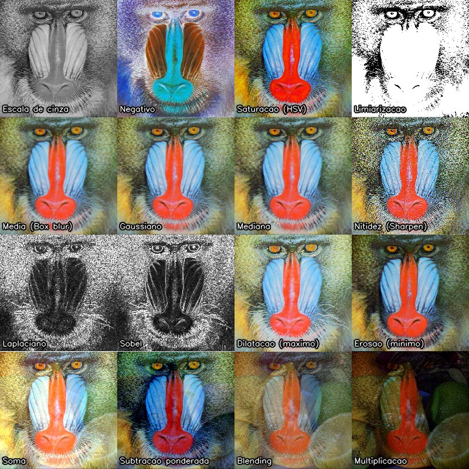
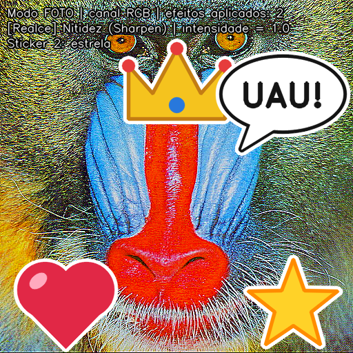

# Stories Lab

Protótipo de aplicativo de efeitos em imagens e vídeo, no estilo dos stories do
Instagram, feito para o Trabalho Grau B da disciplina de Processamento Gráfico:
Fundamentos (Unisinos, 2026/2).

## Equipe

- João Fidellis

## Descrição do Projeto

O programa abre uma janela do OpenCV (HighGUI) e funciona em dois modos:

- **Modo Foto:** carrega uma imagem do disco. Por padrão abre
  `assets/imagens/baboon.jpg`, a mesma imagem usada nos exemplos das aulas.
- **Modo Vídeo:** mostra a webcam em tempo real.

Nos dois modos é possível aplicar 16 efeitos (12 filtros e 4 operações com duas
imagens), escolher o canal de cor em que o efeito age, colar stickers com o
mouse, salvar o resultado e resetar tudo. Os comandos são teclas na janela da
imagem, e as descrições dos filtros aparecem no console.

A imagem original nunca é alterada. O programa guarda uma **lista de efeitos
aplicados** e, a cada quadro, refaz a lista inteira sobre a imagem original (a
foto ou o quadro atual da webcam):

```
resultado = original
para cada (efeito, parametro, canal) na lista:
    resultado = efeito(resultado)
cola os stickers por cima
```

Por causa disso o mesmo código serve para foto e para vídeo, e o reset é só
esvaziar a lista. Aplicar um filtro sobre o resultado do anterior (o extra de
combinação de filtros) também sai sem código a mais.

## Como rodar

Precisa de Python 3.9 ou mais novo.

```
cd trab-grau-b
python3 -m venv .venv
source .venv/bin/activate          # no Windows: .venv\Scripts\activate
pip install -r requirements.txt
python main.py                     # abre a foto padrão
python main.py minha_foto.jpg      # abre outra foto
```

O `requirements.txt` limita o OpenCV a versões abaixo da 5, porque a 5.x
removeu o `CascadeClassifier`, usado na detecção de rosto.

No macOS, na primeira vez que a webcam for ligada, o sistema pede permissão de
câmera para o terminal (ou para o VS Code).

## Controles

As teclas valem com a janela da imagem em foco.

| Tecla | Ação |
|---|---|
| `←` / `→` | Efeito anterior / próximo. Mostra a descrição no console antes de aplicar |
| `↑` / `↓` | Aumenta / diminui o parâmetro do efeito selecionado |
| `Enter` ou `Espaço` | Aplica o efeito selecionado |
| `c` | Troca o canal: RGB, R, G, B |
| `z` | Desfaz o último efeito |
| `1` a `6` | Escolhe o sticker |
| Clique esquerdo | Cola o sticker na posição do clique |
| Clique direito | Remove o último sticker |
| `d` | Liga e desliga o sticker automático nos rostos |
| `f` | Abre outra foto (caminho digitado no console) |
| `i` | Troca a segunda imagem usada nas operações |
| `w` | Liga e desliga a webcam (modo vídeo) |
| `s` | Salva o resultado em `saidas/` |
| `r` | Reset: volta para a imagem original |
| `h` | Mostra a ajuda no console |
| `q` ou `Esc` | Sai |

As teclas são lidas com `cv.waitKeyEx`, e não com `cv.waitKey`. O `waitKey`
devolve só os 8 bits de baixo do código, e as setas têm um código diferente em
cada sistema (no Windows, por exemplo, as quatro viram 0). A tabela `SETAS` em
`main.py` guarda os códigos do macOS, do Linux e do Windows.

## Estrutura do Projeto

| Arquivo | Descrição |
|---|---|
| `main.py` | Janela, teclado, mouse, modos foto e vídeo, salvar e reset |
| `efeitos.py` | Os 16 efeitos com descrição e parâmetro, e a aplicação por canal |
| `stickers.py` | Carrega os stickers, cola com transparência e detecta rostos |
| `assets/imagens/` | Foto padrão (`baboon.jpg`) e segunda imagem das operações (`fruits.jpg`) |
| `assets/stickers/` | Stickers PNG com canal alfa |
| `requirements.txt` | Dependências: OpenCV e NumPy |

## Como os requisitos foram atendidos

### Filtros

Os filtros seguem as funções vistas nas aulas "Filtros de Imagens no OpenCV" e
"Processamento de Imagens".

| # | Efeito | Tipo | Função OpenCV | Parâmetro (padrão) |
|---|---|---|---|---|
| 1 | Escala de cinza | Cor | `cvtColor(BGR2GRAY)` | |
| 2 | Negativo | Cor | `bitwise_not` (255 - valor) | |
| 3 | Saturação (HSV) | Cor | `cvtColor(BGR2HSV)`, `split` e `multiply` no S | fator (1.5) |
| 4 | Limiarização | Intensidade | `threshold` | limiar K (84) |
| 5 | Média (Box blur) | **Suavização** | `blur` | tamanho do kernel (5) |
| 6 | Gaussiano | **Suavização** | `GaussianBlur` | tamanho do kernel (5) |
| 7 | Mediana | Estatístico | `medianBlur` | tamanho do kernel (5) |
| 8 | Nitidez (Sharpen) | **Realce** | `filter2D` com o kernel da aula | intensidade (1.0) |
| 9 | Laplaciano | **Realce** | `Laplacian` | tamanho do kernel (3) |
| 10 | Sobel | Bordas | `Sobel` em x e em y, depois `magnitude` | tamanho do kernel (3) |
| 11 | Dilatação | Estatístico (máximo) | `dilate` | tamanho do kernel (3) |
| 12 | Erosão | Estatístico (mínimo) | `erode` | tamanho do kernel (3) |

A nitidez usa o kernel da aula com uma intensidade `k` ajustável:

```
[  0    -k     0 ]
[ -k   1+4k   -k ]
[  0    -k     0 ]
```

Com `k = 1` ele é exatamente o `[0,-1,0; -1,5,-1; 0,-1,0]` do slide. O limiar
padrão de 84 também vem do exemplo de binarização da aula.



### Operações com duas imagens

A segunda imagem é redimensionada para o tamanho da atual antes da conta. Por
padrão é `fruits.jpg`, e a tecla `i` troca por outra.

| # | Operação | Fórmula | Função OpenCV | Parâmetro (padrão) |
|---|---|---|---|---|
| 13 | Soma | g = f1 + p·f2 | `addWeighted(f1, 1, f2, p, 0)` | peso p (0.5) |
| 14 | Subtração ponderada | g = f1 - p·f2 | `addWeighted(f1, 1, f2, -p, 0)` | peso p (0.5) |
| 15 | Blending | g = α·f1 + (1-α)·f2 | `addWeighted(f1, α, f2, 1-α, 0)` | alfa (0.5) |
| 16 | Multiplicação | g = f1·f2 / 255 | `multiply(f1, f2, scale=1/255)` | |

As funções do OpenCV saturam o resultado entre 0 e 255. A mesma conta feita
direto com arrays NumPy `uint8` daria a volta (250 + 10 = 4), por isso as
operações usam `addWeighted` e `multiply` em vez de `+` e `*`.

### Descrição dos filtros

Ao selecionar um efeito com as setas `←` e `→`, antes de aplicar, o console
mostra o tipo, o que ele faz e qual parâmetro pode ser ajustado:

```
[Suavização] Gaussiano: Passa-baixa com pesos gaussianos: o centro pesa mais que as bordas, então borra de forma mais natural.
  Parâmetro: tamanho do kernel = 5 (ajuste com as setas ↑ e ↓). Enter aplica.
```

A janela também mostra no canto superior o efeito selecionado e o valor atual
do parâmetro.

### Seleção de canais

A tecla `c` alterna entre RGB, R, G e B. Cada efeito aplicado guarda o canal
que estava selecionado naquele momento:

- **RGB:** o efeito age na imagem inteira.
- **R, G ou B:** a imagem é separada com `cv.split`, o efeito age só naquele
  canal, e os canais são juntados de volta com `cv.merge`.

Enquanto um canal único está selecionado, a janela mostra só aquele canal (os
outros dois zerados), para que o resultado do filtro nele fique visível.
Voltando para RGB, aparece a imagem colorida com o efeito aplicado apenas no
canal escolhido.

Escala de cinza e saturação não mudam nada quando aplicadas em um canal só,
porque um canal isolado já é uma imagem de uma cor.

### Stickers

São 6 stickers PNG com canal alfa (`coracao`, `estrela`, `oculos`, `coroa`,
`balao` e `gato`), escolhidos com as teclas `1` a `6` e colados com o clique
esquerdo do mouse, centralizados no ponto clicado. Eles são lidos com
`cv.IMREAD_UNCHANGED` para manter o quarto canal.

A colagem usa a fórmula de mistura por alfa da aula:

```
C = c1 * alfa + c2 * (1 - alfa)
```

`c1` é a cor do sticker, `c2` a cor da imagem embaixo e `alfa` o canal alfa
dividido por 255. A conta é feita de uma vez em toda a região do sticker com
NumPy. Quando o sticker passa da borda da imagem, só a parte que cabe é colada.

Os stickers ficam numa lista separada dos efeitos e são desenhados sempre por
cima deles. Funcionam nos dois modos, mas no vídeo ficam parados na tela.

### Interface, salvar e reset

- A interface é a HighGUI do OpenCV junto com o console, como o enunciado
  permite.
- `f` carrega outra foto e `w` liga e desliga a webcam (`cv.VideoCapture(0)`).
  O quadro da webcam é espelhado, como numa câmera frontal.
- `s` salva o que está na janela, sem o texto do canto, em
  `saidas/resultado_<data>_<hora>.png`. No modo vídeo salva o quadro atual.
- `r` esvazia as listas de efeitos e de stickers, volta o canal para RGB e
  desliga a detecção de rosto.

Fotos grandes são reduzidas para caber em 960 x 720 ao abrir, para a janela
caber na tela e o vídeo rodar sem travar. Assim o clique do mouse cai direto na
coordenada do pixel.

### Extras

- **Combinação de filtros:** cada `Enter` acrescenta um efeito à lista, e cada
  um age sobre o resultado do anterior. A tecla `z` desfaz o último.
- **Detecção de rosto:** a tecla `d` liga o Haar Cascade frontal que vem com o
  OpenCV (`haarcascade_frontalface_default.xml`). Para cada rosto encontrado, o
  sticker selecionado é redimensionado para a largura do rosto e posicionado:
  os óculos na altura dos olhos e os outros, como as orelhas de gato, no alto
  da cabeça. Funciona na foto e na webcam. A detecção roda na imagem original
  em tons de cinza, para os filtros aplicados não atrapalharem.

## Checklist de Requisitos

- [x] Modo foto: carregar imagem do disco
- [x] Modo vídeo: webcam em tempo real, com iniciar e parar
- [x] Pelo menos 10 filtros (12 filtros e 4 operações)
- [x] Filtro de suavização (média e gaussiano)
- [x] Filtro de realce (nitidez e laplaciano)
- [x] Seleção de canal: imagem inteira ou só R, G ou B, exibindo o canal escolhido
- [x] Pelo menos 3 operações com duas imagens (soma, subtração ponderada, blending e multiplicação)
- [x] Descrição do filtro e dos parâmetros antes de aplicar
- [x] Pelo menos 5 stickers com canal alfa (são 6)
- [x] Sticker posicionado com o clique do mouse
- [x] Salvar a imagem ou o quadro do vídeo
- [x] Resetar todas as operações
- [x] Extra: combinação de filtros em sequência
- [x] Extra: stickers automáticos com detecção de rosto
- [ ] Extra: interface com biblioteca externa
- [ ] Extra: stickers animados por spritesheet

## Screenshot



Saturação e nitidez aplicadas em sequência, com quatro stickers colados.

## Informações Técnicas

| Item | Valor |
|---|---|
| Linguagem | Python 3.9+ |
| Bibliotecas | OpenCV 4.x (`opencv-python`) e NumPy |
| Interface | HighGUI do OpenCV e console |
| Plataforma testada | macOS (Apple Silicon), Python 3.9 e OpenCV 4.14 |

## Referências e créditos

- Slides da disciplina, de Rossana Baptista Queiroz: "Filtros de Imagens no
  OpenCV", "Processamento de Imagens & Visão Computacional" e "Sistemas de
  Cores & Introdução ao Processamento de Imagens".
- GONZALEZ, R. C.; WOODS, R. E. *Digital Image Processing*. Pearson, 2018.
- Documentação oficial do OpenCV: https://docs.opencv.org/4.x/
- Imagens de teste `baboon.jpg` e `fruits.jpg`: pasta `samples/data` do
  repositório do OpenCV (https://github.com/opencv/opencv).
- Detector de rosto: `haarcascade_frontalface_default.xml`, que já vem no
  pacote `opencv-python`.
- Stickers: desenhados para este trabalho.
